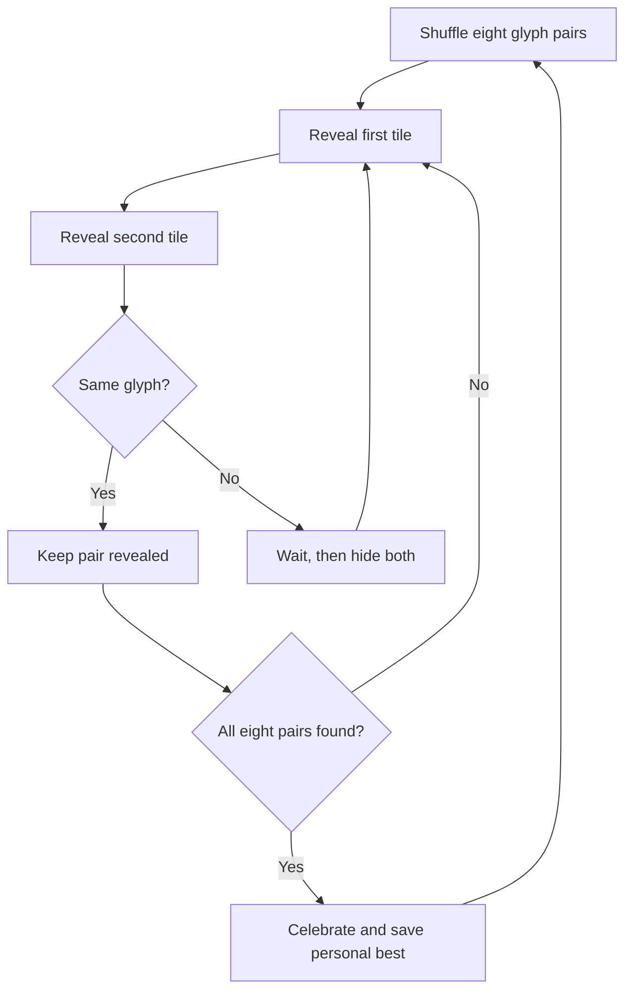

# Pairlight

A small space to reset your attention. Pairlight is a polished, keyboard-accessible memory game built with Vue 3, TypeScript, and Vite. Match eight pairs of original neon glyphs and find your flow state.

**Play now:** [oscarmmi.github.io/memory](https://oscarmmi.github.io/memory/)

## How to play

- Reveal two tiles at a time and remember where each glyph appears.
- A pair stays glowing when you find a match. A mismatch turns back over after a short pause.
- Find all eight pairs in as few moves and as little time as you can.
- Use the pointer or tap to reveal a tile. Use the arrow keys to move the highlight and **Enter** or **Space** to flip.
- Press **R** or choose **New game** to shuffle and restart.
- Your personal best is saved in this browser. Moves are ranked first, with time used to break ties.

## Run locally

```sh
npm install
npm run dev
```

Run the pure game-logic tests and create a production build with:

```sh
npm test
npm run build
```

## Game loop



## Built with

- Vue 3 and TypeScript
- Vite with a `/memory/` deployment base
- Vitest for game-logic coverage
- GitHub Actions and GitHub Pages for deployment
